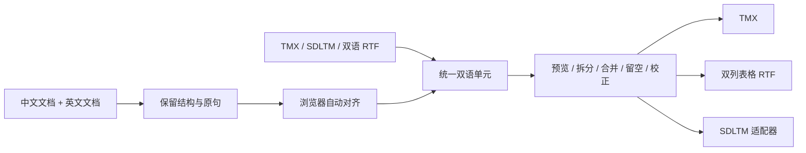

# 纯静态 Web 翻译资料转换与中英对齐调研

调研日期：2026-11-06。目标项目：Silvite Translate Lab。

## 结论与范围

TMX、常见双列表格 RTF 和 SDLTM 读取都有可采用的公开实现基础；中英自动对齐也有浏览器推理与 WASM 路线。最需要补齐的是**新建 SDLTM 时与新文本对应的原生哈希、分词数据和模糊索引**。

用户给出的已验证技术文档和五组真实工具样本均纳入参考。真实样本能够补充数据库结构、编码和兼容性参照，但样本里的索引值不能直接套给新文本。本轮未找到可直接部署到浏览器、完整重建这些派生数据的开源 SDLTM 写入器；这不代表其他地方一定不存在。

成品约束：文件解析、对齐、转换、下载均在浏览器执行；JavaScript、WASM、模型文件可随静态站点提供。用户使用时无需 Trados、Glossary Converter、Python、Node、本机服务或转换后端。开发时用桌面软件做兼容性核验不构成成品依赖。

本轮完成源码、帮助文档、发布包和真实样本的静态分析；没有修改业务功能、安装项目依赖或运行测试，也没有声称转换功能已接入或通过原生 Trados 验证。

## 1. 本机软件与公开实现

本机快捷方式指向的软件版本：

| 软件 | 本机版本 | 已读取的依据 |
| --- | --- | --- |
| SDL Trados Studio 2021 | 16.0.0.2838 | 可执行文件版本信息 |
| Glossary Converter | 6.0.7588.22667 | 可执行文件版本信息及配置文件 |

### Trados 的公开路径

RWS 官方示例用 `FileBasedTranslationMemory` 创建 SDLTM，指定语言、识别器、分词设置和 `FuzzyIndexes`，再用 SDK 导入/导出 TMX。[S1]

RWS 社区的 Translation Memory Management Utility 有真实的创建、导入和导出源码。其项目目标为 `net48`，引用本机 Trados 目录里的 `Sdl.LanguagePlatform.*` 和 `Sdl.Core.TM.ImportExport.dll`。插件源码开放不等于 SDK 内核源码开放，这条调用路径不适合作为静态站点的运行时。[S2]

社区的 SDLTM Anonymizer 还公开了自定义字段读取、Segment XML 序列化及直接更新 SQLite 的代码。这些 SQL 可以帮助保留元数据；其内容更新函数本身未同步重建哈希或模糊索引，不能把它当作完整新建器。[S3]

### Glossary Converter 的公开路径

作者的 SDLTM 帮助页描述 TMX 中转，并调用 Windows 上的 Trados 工具；其系统要求明确写出 SDLTM 读写需要 Studio 2017 或以上。帮助页使用了旧的 Workbench 名称，不能据此认定本机 v6 的具体 helper/API 与该文字完全一致。[S4]

本机安装目录有 SQLite、NPOI、LibreOffice/UNO 相关组件，但依赖文件名只能说明所带组件，不能证明具体格式通道的实现或整个程序开源。本轮未找到其完整转换器的开放源码授权，不能直接把桌面程序打包进网页。

## 2. 用户提供的真实样本

样本目录：`D:/桌面/文档/新建文件夹`。包含 9、10、19、20、25 五组；每组有 RTF、TMX、SDLTM 和 ZIP，部分另有日志。ZIP 内列出的三个文件与外部文件尺寸对应，本轮没有把它们作为额外独立样本。

| 组 | RTF 表格行数 | TMX TU 数 | SDLTM TU 数 | fuzzy_data 行数 | translation_unit_fragments 行数 |
| --- | ---: | ---: | ---: | ---: | ---: |
| 9 | 42 | 42 | 41 | 41 | 41 |
| 10 | 49 | 49 | 48 | 48 | 48 |
| 19 | 30 | 30 | 30 | 30 | 30 |
| 20 | 20 | 20 | 19 | 19 | 19 |
| 25 | 42 | 42 | 42 | 42 | 42 |
| 合计 | 183 | 183 | 180 | 180 | 180 |

### 内容对应与空侧处理

对 TMX 和 SDLTM 的中英文本分别解码，统一换行为 LF 并去除首尾空白后，SDLTM 中的 **180 条全部能在对应 TMX 中找到相同句对**。这证明的是本批样本的文本对应，不是其他内容、格式或任意转换器的无损性。

TMX 中未出现在 SDLTM 的三条是：

- 第 9 组第 42 条：中英双空。
- 第 20 组第 20 条：中英双空。
- 第 10 组第 20 条：中文为空，英文有 122 个字符。

第 10 组日志仍记录写入 49 条、错误 0；数据库实际为 48 条。因此日志成功计数不能代替输出内容核对。新网站应保留空侧及原行位置，将单边内容交给用户校正；双空过滤应记录数量。目标格式无法表达某条记录时，应在导出前明确列出，不能悄悄丢弃。

五份 TMX 的 `creationtool` 均为 ABBYY Aligner，`srclang` 均为 `en-US`；但每个 TU 的首个变体为 `zh-CN`，SDLTM 方向为 `zh-CN → en-US`。导入器需要按 `xml:lang` 识别变体，并让用户确认工作方向，不能根据变体顺序或文件头独自决定中英列。

### RTF 的真实类型

五份 RTF 都是普通双列表格，未见旧 Trados 分段标记、`tw4win` 样式或隐藏文字控制。应优先覆盖这种格式，但它们不足以证明对旧 Trados RTF、复杂合并单元格及任意单语 RTF 的兼容性。

样本中的关键编码规则：

- `\cell` 结束单元格，`\row` 结束行；同一行前后会重复出现 `\trowd`，不能按该控制字次数计行。
- 中文使用有符号 UTF-16 `\uN`，后接 `\'3f` 回退字符。须按 `\ucN` 跳过回退；负数不能直接当成无效字符。
- 字体声明 `cpg1251` 不覆盖 Unicode 控制字的含义。
- 单元格内的段落和换行应保留，不能先将整份 RTF 降为一条纯文本再猜中英对应。

### SDLTM 的实际结构

五份数据库具有相同的字段结构：20 张非内部表、25 个显式 SQLite 索引。`translation_memories.tucount` 与实际 TU 数对应；`fuzzy_indexes=15`，方向均为 `zh-CN → en-US`，描述字段为 `Created by Glossary Converter`。

`parameters` 包含：`VERSION=8.06`、`VERSION_CREATED=8.10`、`FREQUENCYTOP=1000`、`TokenDataVersion=1`、`AlignmentDataVersion=1`。同一个 VERSION 值不保证数据库列结构相同，适配器应检查实际表和字段。

与技术文档所用的 RWS 官方空模板相比，真实样本多出：

| 范围 | 增加的项目 |
| --- | --- |
| 表 | `trans_model`、`trans_model_rev`、`translation_unit_fragments`、`translation_unit_idcontexts`、`vocab_src`、`vocab_trg`、`vocabfilter` |
| translation_units 字段 | `source_token_data`、`target_token_data`、`alignment_data`、`align_model_date`、`insert_date`、`tokenization_sig_hash` |

此外，每条 TU 都有源/目标分词 BLOB、分词签名和对应的模糊索引行。`fuzzy_data.fi1/fi2/fi4/fi8` 是由 `|` 分隔的整数文本；其存在与编码形态已确认，生成算法尚未确认。

本批样本的 `resources`、`tm_resources`、词汇表和翻译模型表为空，`alignment_data` 也全部为空。不能用这些样本推定所有 SDLTM 都不需要这些表里的数据。

Segment XML 的正文位于 `Elements` 中；本批全是 Text，没有 Tag，也没有技术文档示例中的 `LastElement`。读取器应按结构读取 `Elements`，避免通过全文收集 `Value` 而重复拼入缓存字段；含标签的格式必须另外处理。

真实的 `tokenization_sig_hash=9077876807420713840`，已超出 JavaScript 安全整数范围。SQLite 读写层需要精确处理 int64，不能经过 `Number` 再转回 BigInt。

本轮重新下载官方空模板确认：大小 245760 字节、13 张表、零 TU、零 fuzzy_data。SHA-256 与用户技术文档一致：`d0e367a1de5d1ed9f65d9cd031e8d9c551cb5fe4ecb1a5ec948f5a5e2db70eaf`。[S5]

结构导出见本目录的 `2026-11-06-sdltm-schema.sql`，样本摘要、哈希及差异见 `2026-11-06-sample-inventory.json`。未将原始语料、用户字段或整个样本数据库复制进网站资源。

## 3. 社区项目选型

许可证栏记录所查源码/包声明；代码、模型权重、字典和被引用 SDK 分别确认，不能互相替代。

| 候选 | 真实实现和方向 | 对纯浏览器的用途 | 许可 |
| --- | --- | --- | --- |
| Maxprograms `sdltm` 2.5.3 | 直接读取 SQLite 和 Segment XML，SDLTM → TMX | 首选读取参考；替换 Node 文件系统、SQLite 和 XML 依赖 | EPL-1.0 |
| Maxprograms TMXEditor | SDLTM 转换调用上面的 TMReader | 编辑交互参考；不是另一套 SDLTM 写入器 | EPL-1.0 |
| Trados Studio Resource Converter | Java/JDBC 读取 SDLTM → TMX；正则处理 Segment | 格式参考，不建议直接照搬正则 | LGPL v3；版本选择声明未确认 |
| RWS SDK 示例和社区 TM Tool | 创建 SDLTM、TMX 导入/导出，依赖 Trados DLL | 行为与结构参考，不能作为成品运行时 | 仓库 Apache-2.0；不覆盖 SDK DLL |
| 官方 SQLite WASM | 浏览器 SQLite，支持字节导入/导出和精确 int64 | SDLTM 读写的底层候选 | 官方版权放弃声明 |
| Pandoc 3.13 WASM | RTF ↔ 文档 AST，包含表格 reader/writer | 常见 RTF 结构解析候选；仍需双语列和 TMX 适配 | 内核 GPL-2.0-or-later；JS 包装层 MIT |
| `rtf.js` 3.0.9 | RTF → HTML/DOM | 预览候选，所查实现缺表格行列和 RTF 写出能力 | MIT |
| Okapi RTFFilter | 读取 Trados 特殊样式与分段标记 | 旧版双语 RTF 状态机参考，不能当通用双向转换器 | Apache-2.0 |
| `@bitextual/hunalign` 0.0.3 | C++ 的 Emscripten/TypeScript 包装，输出对齐路径 | 轻量 WASM 候选，需修包装并补中文分词 | LGPL-3.0-only |
| Vecalign | 跨语言句向量加动态规划 | 语义对齐的 JS 移植参考，原版 Python/Cython | Apache-2.0 |
| Bertalign | 中英等语言、两阶段动态规划 | 算法参考，原版依赖 Python/PyTorch 等 | GPL-3.0 |
| Transformers.js + 多语 MiniLM | 在浏览器通过 ONNX 生成句向量 | 语义对齐的推理候选，不等于完整对齐器 | 运行库/底模 Apache-2.0；转换权重单独核对 |

### SDLTM 读取与写入应分别评价

Maxprograms 的 TMReader 实际读取 `translation_memories`、`translation_units` 和部分属性，解析 Segment 中的 Text/Tag，再输出 TMX 的文本和 `bpt/ept/ph`。它不创建 SDLTM，且使用 `node:sqlite`、`node:fs`；其 XML 依赖也有 Node 模块引用，因此不能直接在 Vite 中 import 后就当作浏览器库。[S6]

用户技术文档已经给出“真实空模板 + SQLite 注入 + Segment XML”的 L2/L3 实证，应该保留这条可迁移路线。文档使用的 SHA-256 截断哈希是占位计算，模糊索引未重建；新样本补充了这些字段的真实形态，仍未证明任意新句子的派生数据如何生成。

RWS API 区分旧版哈希、重建 TU 索引和重算模糊统计。SQLite 的 `CREATE INDEX` 只负责索引已有列值，不能自动生成 Trados 的分词、片段哈希或 `fuzzy_data`。[S7]

因此可复制的是 schema、约束、索引定义、版本及语言配置参考；已有 TU 的派生数据只可在内容及关联关系保持一致的情况下保留。向模板注入新内容时，不能保留旧文本对应的索引并宣称原生检索正确。

SQLite WASM 的 oo1 API 明确支持在启用 BigInt 的构建中绑定/读取 int64；底层提供 `sqlite3_deserialize` 与 `sqlite3_js_db_export`。单次转换先用内存数据库，无需为了读写文件强制引入 OPFS。`sql.js` 可作备选，但其读取 BigInt 与绑定 BigInt 是不同能力，不能仅凭读取选项认定双向精度安全。[S8]

### RTF 不能只按扩展名分成一种业务格式

| 输入类型 | 处理方式 |
| --- | --- |
| 当前样本式双列表格 | 保留行列和单元格内容，用户确认原文/译文列，再形成双语单元 |
| 普通单语 RTF | 提取结构后，与另一语言文档对齐；单份文件不能凭空产生译文 |
| 旧 Trados uncleaned/tagged RTF | 保留隐藏内容、样式及分段标记，采用独立状态机 |

Pandoc 3.13 有官方 WASM 发布及浏览器 WASI 包装，RTF reader/writer 实际处理表格控制字。适合评估常见 RTF → JSON AST → 双语行的路线；简单双栏 RTF 导出也可直接由 JS 生成。复杂表格和原排版不应承诺完全还原。Pandoc reader 会跳过隐藏文字，不能直接用于提取旧 Trados 文件中的隐藏源文；WASM 应按需加载、自托管。[S9]

Okapi 的实际 `RTFFilter.java` 识别旧 Trados 分段状态；官方明确它是只读过滤器，不能回写合并原文件。它适合参考专用解析规则。[S10]

纯文本 striprtf、JS stripRtf 和 iarna/rtf-parser 也已考察。前两者丢失表格结构；后者明确缺表格支持并带 Node/stream 依赖，均不适合作为本需求的主转换核心。

### 中英自动对齐

建议主方案评估浏览器多语句向量 + JS 动态规划，参考 Vecalign；轻量选项评估 Hunalign WASM。两条路线都应保留原文、句段索引、空对应和人工修改记录。

Hunalign 包的 TypeScript 源码确实将字节数组写进 WASM 内存文件系统并运行对齐器，发布包包含 JS、声明文件和 WASM。`run()` 同步执行，应放 Worker；当前包装的 `printLog` 在多次运行间未清空，须修复后才能复用实例。输出是路径边界及分数，需要按相邻边界还原句段范围。[S11]

Hunalign 的基础转移包括 1:1、1:2、2:1、1:0、0:1，使用长度和词典。它支持 UTF-8，但词典匹配仍依赖分词；中文需先分词，且词典采取相同规则。本轮未锁定许可清楚且适合随站点分发的中英词典，也未实测中英质量。分数不是校准后的正确概率。

Transformers.js 支持浏览器 CPU/WASM 和可选 WebGPU 推理。多语 MiniLM 是候选底模，可生成跨语言句向量；仍需全局对齐算法处理有上限的多句对应、漏译和长度限制。现成转换仓的量化 ONNX 单文件约 118 MB，应延迟加载并缓存；模型包还包含 tokenizer 等资产。底模许可已确认，转换权重的独立许可说明尚需固定。[S12]

Vecalign/Bertalign/Lingtrain/LF Aligner 的原版依赖 Python、Cython、桌面程序或外部工具，不能整体直接放进静态站点。可移植算法或复用 WASM 内核；不能将“有网页界面”当作“计算完全在浏览器”。单调对齐不能自动恢复交叉换序，需要手动锚点或重排入口。

## 4. 接入 Translate Lab 的建议设计

建议增加“语料工具”入口，提供“格式转换”和“中英对齐”两个流程，共用双语编辑器。个人学习使用无需先做班级、教师和作业系统。

内部数据应包含：文档及句段 ID、语言、原始文本/片段标记、两侧句段范围、元数据、对齐分数、复核状态和空侧信息。SDLTM 只作为导入导出格式，不作为整个网站的内部数据结构。

| 项目位置 | 接入用途 |
| --- | --- |
| `src/App.tsx`、`src/components/Sidebar/Sidebar.tsx` | 新工具入口，按需加载界面 |
| `src/services/document/fileParser.ts`、`officeParser.ts` | 复用文件识别和已有解析能力；给对齐增加保留段落/单元格的结构输出 |
| 建议新增 `src/services/corpus/` | 双语模型、TMX、RTF、SDLTM 适配器 |
| 建议新增 `src/services/alignment/` | 分句、可选分词、向量或 Hunalign、对齐路径 |
| 建议新增 Worker | SQLite、WASM、模型推理等重计算，进度与取消 |
| 建议新增独立 store | 导入状态、双语行、人工校正、会话保存 |

现有 document chunker 按翻译请求长度切块，不提供双语句段关系；现有纯文本解析结果也会失去表格和部分段落信息，不能直接当作对齐结构。XML 若用 DOMParser 可在页面线程解析；Worker 应选兼容其环境、能保留混合内容的 XML 解析器。重计算完成后返回结构化数据，不传不可用的 DOM 对象。

建议实施顺序：

1. 建立统一双语模型、预览校正、TMX 和样本式 RTF 双向通道，同时保留空侧记录。
2. 加入 SDLTM 读取，按实际 schema 适配；保留日期、用户、自定义字段与标签，不能支持的内容给出明确提示。
3. 接入自动对齐及手动锚点，多句对应和未匹配片段可见；大型模型按需加载。
4. 以真实样本 schema 和已有模板注入路线实现 SDLTM 写出候选，逐项解决派生数据，记录兼容范围。
5. 原生验收覆盖打开、内容、TMX 导出、精确/模糊检索、编辑及重新打开；不能只以 SQLite 能打开或第三方能读为完成标准，也不能把每次都要求用户用 Trados 修复作为最终纯浏览器交付条件。

最后一步是后续验收设计，本轮没有执行，也没有替用户修改本机 Trados 的库或设置。

## 5. 主要来源

- [S1：RWS 创建文件型记忆库](https://github.com/RWS/studio-api-docs/blob/main/apiconcepts/translationmemory/creating_a_file_based_translation_memory.md)
- [S2：社区 TMCreator](https://github.com/RWS/Sdl-Community/blob/master/Trados%20Translation%20Memory%20Management%20Utility/Sdl.Community.Utilities.TMTool.Lib/TMCreator.cs)、[项目依赖](https://github.com/RWS/Sdl-Community/blob/master/Trados%20Translation%20Memory%20Management%20Utility/Sdl.Community.Utilities.TMTool.Lib/Sdl.Community.Utilities.TMTool.Lib.csproj)
- [S3：SqliteTMService](https://github.com/RWS/Sdl-Community/blob/master/Trados%20Data%20Protection%20Suite/SDLDataProtectionSuite/SdlTmAnonymizer/Services/SqliteTMService.cs)、[SegmentService](https://github.com/RWS/Sdl-Community/blob/master/Trados%20Data%20Protection%20Suite/SDLDataProtectionSuite/SdlTmAnonymizer/Services/SegmentService.cs)
- [S4：Glossary Converter SDLTM 帮助](https://cerebus.de/glossaryconverter/help/SDLTM.html)、[系统要求](https://cerebus.de/glossaryconverter/help/SystemRequirements.html)、[条款](https://cerebus.de/glossaryconverter/help/TermsandConditions.html)
- [S5：RWS 官方空模板](https://github.com/RWS/trados-studio-api-samples/blob/master/ProjectAutomation/Sdl.SDK.ProjectAutomation.Samples.Examples/SampleFiles/General%20En-Fr.sdltm)、[仓库许可](https://github.com/RWS/trados-studio-api-samples/blob/master/LICENSE)
- [S6：Maxprograms SDLTM](https://github.com/maxprograms-com/sdltm)、[TMReader 源码](https://github.com/maxprograms-com/sdltm/blob/main/ts/TMReader.ts)、[许可](https://github.com/maxprograms-com/sdltm/blob/main/LICENSE)、[TypesXML SAXParser](https://github.com/maxprograms-com/TypesXML/blob/main/ts/SAXParser.ts)
- [S7：FileBasedTranslationMemory API](https://developers.rws.com/studio-api-docs/16.2/api/translationmemory/Sdl.LanguagePlatform.TranslationMemoryApi.FileBasedTranslationMemory.html)、[语言方向重建接口](https://developers.rws.com/studio-api-docs/16.1/api/translationmemory/Sdl.LanguagePlatform.TranslationMemoryApi.ITranslationMemoryLanguageDirection.html)
- [S8：SQLite WASM oo1](https://sqlite.org/wasm/doc/trunk/api-oo1.md)、[C API 与导入导出](https://sqlite.org/wasm/doc/trunk/api-c-style.md)、[许可](https://sqlite.org/wasm/doc/trunk/license.md)、[sql.js API 源码](https://github.com/sql-js/sql.js/blob/master/src/api.js)
- [S9：Pandoc 3.13 发布](https://github.com/jgm/pandoc/releases/tag/3.13)、[浏览器包装](https://github.com/jgm/pandoc/blob/3.13/wasm/pandoc.js)、[RTF reader](https://github.com/jgm/pandoc/blob/3.13/src/Text/Pandoc/Readers/RTF.hs)、[RTF writer](https://github.com/jgm/pandoc/blob/3.13/src/Text/Pandoc/Writers/RTF.hs)、[许可](https://github.com/jgm/pandoc/blob/3.13/COPYING.md)
- [S10：Okapi Tagged RTF 文档](https://okapiframework.org/wiki/index.php/Trados-Tagged_RTF_Filter)、[实际过滤器源码](https://gitlab.com/okapiframework/Okapi/-/blob/main/okapi/filters/rtf/src/main/java/net/sf/okapi/filters/rtf/RTFFilter.java)
- [S11：Hunalign WASM 包装源码](https://github.com/wydengyre/hunalign/blob/230fd91d022a0030d4105421abc7764ac897472c/ts/src/hunalign.ts)、[包定义](https://github.com/wydengyre/hunalign/blob/230fd91d022a0030d4105421abc7764ac897472c/package.json)、[对齐核心](https://github.com/wydengyre/hunalign/blob/230fd91d022a0030d4105421abc7764ac897472c/src/hunalign/alignment.cpp)
- [S12：Transformers.js](https://huggingface.co/docs/transformers.js/index)、[MiniLM 底模](https://huggingface.co/sentence-transformers/paraphrase-multilingual-MiniLM-L12-v2)、[ONNX 转换仓](https://huggingface.co/Xenova/paraphrase-multilingual-MiniLM-L12-v2/tree/main/onnx)
- 补充：[Vecalign](https://github.com/thompsonb/vecalign)、[Bertalign](https://github.com/bfsujason/bertalign)、[Lingtrain](https://github.com/averkij/lingtrain-aligner)、[LF Aligner](https://sourceforge.net/projects/aligner/)
- 补充：[rtf.js](https://github.com/tbluemel/rtf.js)、[striprtf](https://github.com/joshy/striprtf)、[JS stripRtf](https://github.com/sigmaSd/stripRtf)、[iarna rtf-parser](https://github.com/iarna/rtf-parser)、[Trados Studio Resource Converter](https://github.com/TomasoAlbinoni/Trados-Studio-Resource-Converter)

用户技术文档：`D:/Tencent Files/xwechat_files/wxid_ax8gou84useg22_11af/msg/file/2026-11/SDLTM格式转换技术文档.md`。其已有 L2/L3 证据与本轮新增观察分别记录，均未提升为本轮已经取得的原生 Trados L4/L5 结果。
