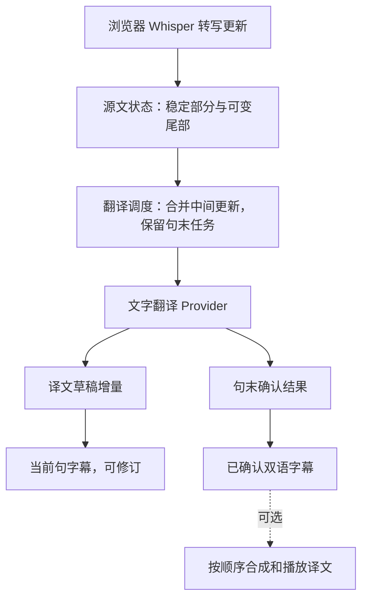

# 转写之后的流式同传：社区实现与本站接入建议

实施状态补记（2026-11-06）：本文件保留调研时的源码快照和建议，文中“当前/尚未实施”指调研阶段。
其后已在本地接入独立翻译调度、在线 SSE、草稿和句末确认；最新实现及检查边界见
[流式字幕实施记录](../realtime-streaming.md)。TTS 与浏览器本机文字翻译尚未接入。

调研日期：2026-11-06。范围以连续双语字幕为主，补充译文语音输出。本轮读取社区源码、协议、
模型卡与本站代码，未接入新翻译引擎、修改业务逻辑、部署或运行社区推理基准。

## 结论

适合本站先移植的是：源文稳定性判断、可修订译文草稿、停顿后的整句确认、独立翻译调度，以及
生成中的译文增量事件。优先沿用浏览器 Whisper 和现有文字翻译服务；社区 Python/CUDA 服务
可以提供算法参照，不能直接作为纯静态网页的依赖。

如果要求翻译本身也完全在浏览器内运行，已有与本站依赖版本一致的官方示例：Transformers.js
3.8.1 的 React 翻译教程在 Worker 内执行 translation pipeline，用 TextStreamer 回传增量文字，
最终构建为静态文件。[S8] 这证明浏览器生成译文流的接口可用，不代表示例的 NLLB 模型已经在本站
完成同传、中文质量或手机性能验证。

## 三个需要同时处理的问题

1. **源文更新**：讲话持续时，STT 增加文字，也可能改写刚才识别的尾部。
2. **翻译决策**：决定等多少后文、哪些译文可以先显示、哪些仍是草稿。
3. **输出传输**：将本次译文生成的增量送到界面；在线可以用 SSE，本机 Worker 可以用 postMessage。

LocalAgreement 的源码会比较连续两轮结果的公共前缀；SimulStreaming 还将已接受译文作为后续
生成的目标前缀。[S1][S2] 因此仅把 HTTP 响应换成逐字输出，还没有解决源文继续变化时的翻译稳定性。
在本站的接入建议中，重复匹配只是稳定性启发式，不将它当作语义正确的保证。

## 读到的实现

| 项目与具体入口 | 源码做法 | 本站可借鉴内容与适用边界 |
| --- | --- | --- |
| WhisperStreaming：`whisper_online.py` 的 `HypothesisBuffer.flush()` | 对比两次识别结果，接受相同前缀，保留未确定尾部；还处理重叠窗口重复词。[S1] | 在 STT 与翻译之间显式区分稳定源文和可变尾部。它处理的是反复识别的稳定性，不能单独解决译文词序。 |
| SimulStreaming：`simulstreaming_translate.py` 的 `SimulLLM.process_iter()` | 累加源文，带已接受目标前缀继续翻译；比较上轮与本轮的未确认译文，分别产生确认部分和草稿；结束时释放余下文字。[S2] | 借鉴持续语段上下文、前缀和草稿分层。其 LLM 实现使用 Python / CTranslate2 / CUDA，当前 MiMo 接法也没有其解码前缀接口。 |
| NoLanguageLeftWaiting：`OnlineTranslation.process()` | 将 NLLB 接成在线翻译器，返回 `validated, buffer`，使用 LocalAgreement；Python Transformers / CTranslate2 两种后端。[S3] | 最接近“转写文字持续进来 → 稳定译文 + 活动草稿”的抽象。不能把 Python 包直接放进浏览器执行。 |
| WhisperLiveKit：`translation_processor.py`、`diff_protocol.py` | 翻译独立消费队列；静音、换说话人和流结束触发收尾。界面协议首次发送 snapshot，随后发送增量行和替换的 buffer。[S4][S5] | 借鉴翻译与识别解耦、历史字幕追加、活动草稿替换，以及取消和错误处理。WebSocket 是它的会话传输方式。 |
| AlignAtt4LLM：README、`docs/mt_server_protocol.md` | 读取经过校准的模型注意力，决定哪些目标词已有已确认源文支持；协议区分源文 words/tail、目标 committed_delta/buffer_text。[S6][S7] | 注意力判断需要模型内部推理接口。可以移植队列、版本和草稿协议，不能仅凭 MiMo 的文本增量复现其注意力策略。 |

重要细节：AlignAtt4LLM 协议对非 final 的 accepted target 采用追加语义，但 final 会对本句做质量
处理，并允许按行替换先前部分结果。[S7] 不能将整个产品描述成“字幕和已播放语音永远无需更正”。

## 本站现状：从代码确认

| 代码入口 | 观察与影响 |
| --- | --- |
| `cloud-functions/api/realtime/translate.js:83` | 上游 `stream: false`，收到完整 content 后返回 JSON；当前实时翻译没有输出译文 token 流。 |
| `src/api/realtimeClient.ts:185` | 等待 `response.json()`，Provider 也没有译文增量回调。 |
| `src/services/realtime/session.ts:323` | 已有 provisional 翻译、节流、取消旧请求及 sequence/revision 保护，可作为基础。 |
| `src/services/realtime/session.ts:279`、`:371` | 串行 ASR 消费在静音/stop 窗口等待 confirmCurrent，而确认会等待在线翻译。由此可推断慢翻译会拖住后续 ASR 消费。 |
| `src/services/realtime/whisper.ts:43` | 本机 Whisper 最长 6000 ms 音频窗、800 ms 重叠、650 ms 静音提交；当前每个窗识别完成后才交文字。流式翻译仍需等待这部分延迟。 |
| `src/services/realtime/providers.ts:35` | TTSProvider 只有接口，未接入语音合成与播放。 |
| `cloud-functions/api/translate.js:123`、`:689`、`:1063` | 普通翻译已有上游 stream、增量提取和 SSE 响应，可复用经过使用的协议处理思路；实时文本翻译的负载更简单，仍需自己的版本和句段规则。 |

这些是当前代码阅读结论，不是本轮实测的延迟数据。本轮没有声称同传功能已完成。

## 建议移植到本站的流程

以下是基于社区实现与现有代码提出的方案，尚未实施：

### 调度与字幕状态

- 将 ASR 队列与翻译队列拆开，确认翻译不阻塞后续识别。已结束语段可以显示“译文处理中”。
- 为讲话语段建立独立 `utteranceId`，不把音频窗 sequence 当作稳定的句段标识；同时携带
  `sourceRevision`、`translationRevision` 和 `requestId`，屏蔽取消后迟到的事件。
- 更新携带本句完整源文快照；同一句保留一个在途任务和一个待处理的最新快照，合并中间草稿更新。
  这与可以丢掉任意源文增量不同：只丢过时的任务，不丢已经收到的原文。句末 final 按序保留。[S7]
- 翻译节流需要末次执行机制，不能只有“间隔没到就 return”，使最后一次更新一直等不到执行。
- 活动译文允许替换，已确认字幕按句保存。可以实验比较连续译文的稳定前缀，但黑盒接口下第一阶段
  宜只把句末结果视为已确认；“显示草稿”和“锁定不可改译文”是不同承诺。
- 标点、停顿、明确结束作为语段结束候选；最长语段另设上限并保留上下文，避免持续讲话无限增长。
  分句阈值及手机/PC 推理频率需用真实课堂语料调节，不从社区 GPU 的数字推断本站速度。

### 在线流式译文

沿用现有文字翻译云函数时，建议使用 `fetch(POST)` 读取 SSE 格式的响应流，继续通过请求正文传源文和
上下文。SSE 为服务端到客户端事件流，[S10] 这条路径无需因社区示例使用 WebSocket 就新增长连接服务。
需要同时修改服务端上游 stream、响应封装、客户端读取与 Provider 回调，只改 UI 不能提前拿到译文。

建议事件携带上述版本字段，区分：

| 事件 | 建议语义 |
| --- | --- |
| start | 开始某个源文版本的翻译，建立本轮草稿。 |
| delta | 只追加本轮生成的新文字；不是跨轮都可以直接追加。 |
| replace / reset | 源文修订或重试后，替换/清空当前草稿，保留已确认历史。 |
| final | 本轮有效完成；只有句末确认任务才能把语段移入已确认区。 |
| error | 显示可恢复失败；保留原文，不把中断的 partial 假装为 final。 |

还需检查代理缓冲、断流、重试后去重、取消是否停止上游，以及停止/退出后的资源清理。
当前普通翻译已有部分可参考实现，但本轮没有执行新的线上 SSE 测试。

### 翻译也在浏览器内的路径

Transformers.js 官方 3.8.1 教程已展示 Worker + TextStreamer + postMessage 的流式翻译，
不要求为了显示生成增量而启动本机服务器。[S8] 可以将同一翻译调度器接到本机 TranslationProvider；
这里使用 Worker 消息，既不需要 SSE，也不需要 WebSocket。

该教程解决一次源文输入的生成流，持续源文更新、稳定性和最终确认仍需前述调度。其 NLLB 示例
不能直接作为手机默认方案：还未完成与 Whisper 并行时的内存、速度、质量和模型分发评估。
NLLB-200-distilled-600M 模型卡标注 CC-BY-NC-4.0、以研究用途为主，[S11] 不应把工具代码许可
等同于权重许可。此次仅确认技术入口，不选定该模型作为站点默认依赖。

### 如需同声播报

LiveKit 的官方 pipeline translator 示例采用 STT → 翻译 LLM → TTS；其 TTS 节点接收文本流，
不支持原生流式输入的合成器会先按句分段。[S9] 对本站，先把可靠短句放入独立播放队列，
按顺序合成与播放；字幕草稿可先显示，未确认尾部不直接朗读。后续才评估更激进的词级合成。

需要保留分段 ID、取消、未播放片段替换、当前播放位置；已播放语音无法通过字幕修订撤回。
手机还需验证点击解锁播放、锁屏/后台、扬声器回录和长时间负载。这些属于未来 TTS 实现边界，
当前站点没有语音同传播报。

## 建议实施顺序与验收

先拆开识别和翻译调度，再将现有在线文字翻译改为增量输出，并实现活动句草稿/句末确认。
之后评估浏览器本机文字翻译和可选 TTS。这样可以分别测量每一步效果，保留手机 CPU 配置。
这不是承诺必须先使用在线翻译；若要求文字也不出浏览器，可直接实验本机 Provider，但仍共用同一调度。

验收应单独记录：语音到首段源文、源文到首个译文、源文到最终译文的 P50/P95，字幕修订幅度，
长语段积压、重复/漏译、数字/人名/否定句、停止与取消表现；同时测试英文→中文和中文→英文。
手机模拟只验布局与交互，iOS/Android 真机负责收音、内存、速度、发热及播放验收。
社区作者报告的服务器模型速度不作为本站目标已达成的证据。

## 来源与固定版本

2026-11-06 用 `git ls-remote` 核对以下公开仓库 main：

| 仓库 | 调研快照 |
| --- | --- |
| ufal/whisper_streaming | `6da90b44b7e50d79695e68166d2a2c7609c75abb` |
| ufal/SimulStreaming | `077ea37d5ab4ff98bc567e4507f140dc4e5d5ad6` |
| QuentinFuxa/WhisperLiveKit | `13ee8515f136e0fd0bf31fb8ab0b63ab10670fa2` |
| QuentinFuxa/NoLanguageLeftWaiting | `74d21d32f276616c61e2bf7eea60b1e7285b5f73` |
| QuentinFuxa/Alignatt4LLM | `2a76daf3f2e522a3f08948b72b8a27b612981991` |

- S1：[WhisperStreaming HypothesisBuffer](https://github.com/ufal/whisper_streaming/blob/6da90b44b7e50d79695e68166d2a2c7609c75abb/whisper_online.py#L328)。
- S2：[SimulStreaming 文本翻译实现](https://github.com/ufal/SimulStreaming/blob/077ea37d5ab4ff98bc567e4507f140dc4e5d5ad6/simulstreaming_translate.py#L173)。
- S3：[NoLanguageLeftWaiting 接口与策略](https://github.com/QuentinFuxa/NoLanguageLeftWaiting/tree/74d21d32f276616c61e2bf7eea60b1e7285b5f73)。
- S4：[WhisperLiveKit 翻译消费](https://github.com/QuentinFuxa/WhisperLiveKit/blob/13ee8515f136e0fd0bf31fb8ab0b63ab10670fa2/whisperlivekit/translation_processor.py)。
- S5：[WhisperLiveKit diff 协议](https://github.com/QuentinFuxa/WhisperLiveKit/blob/13ee8515f136e0fd0bf31fb8ab0b63ab10670fa2/whisperlivekit/diff_protocol.py)。
- S6：[AlignAtt4LLM 原理及推理条件](https://github.com/QuentinFuxa/Alignatt4LLM/tree/2a76daf3f2e522a3f08948b72b8a27b612981991)。
- S7：[AlignAtt4LLM MT 协议、final 和调度语义](https://github.com/QuentinFuxa/Alignatt4LLM/blob/2a76daf3f2e522a3f08948b72b8a27b612981991/docs/mt_server_protocol.md)。
- S8：[Transformers.js 3.8.1 React 浏览器翻译与 TextStreamer](https://huggingface.co/docs/transformers.js/v3.8.1/tutorials/react)。
- S9：[LiveKit 翻译流水线](https://docs.livekit.io/reference/recipes/pipeline_translator/)；[TTS 节点和分句适配](https://docs.livekit.io/agents/logic/nodes/#tts-node)。
- S10：[MDN SSE 事件流](https://developer.mozilla.org/en-US/docs/Web/API/Server-sent_events/Using_server-sent_events)。
- S11：[Meta NLLB-200-distilled-600M 模型卡](https://huggingface.co/facebook/nllb-200-distilled-600M)。

本次也读取了固定快照的许可：SimulStreaming、AlignAtt4LLM 为 MIT，WhisperLiveKit 为 Apache-2.0；
移植代码需保留适用声明，模型权重仍单独确认。没有把社区推理服务作为本站运行依赖，也没有复制其实现代码。
