# SDLTM 转换实现技术说明

更新日期：2026-11-07  
范围：当前 Translate Lab 代码中的 SDLTM 导出实现及其已记录的本地验证证据。

## 1. 结论与范围

当前实现是**统一语料项目 → SDLTM 的实验性导出器**。界面将其描述为 TMX → SDLTM，但导出函数接收 `CorpusProject`，因此可使用从 TMX、双栏 RTF 导入或中英文档对齐得到的当前项目。导出只写项目当前工作方向上的中文和英文纯文本。

当前没有 SDLTM 导入器：语料文件导入入口支持 TMX、RTF 和项目 JSON，不接受 `.sdltm`。因此目前不是 SDLTM ↔ TMX/RTF 的双向互转工具，也不是完整三格式互转。

SQLite、SDLTM 模板和转换均在浏览器内的 Web Worker 完成；运行时不依赖宿主机安装 Trados、Python、Node、本机服务或转换后端。数据库能够通过本地结构检查，不代表 Trados 能原生打开、检索、编辑或保存。产品界面据此注明「不保证兼容 Trados」。

## 2. 转换链路

```mermaid
flowchart LR
  A[TMX / 双栏 RTF / 中英对齐项目] --> B[CorpusProject 当前快照]
  B --> C[选择中英工作方向、编辑或排除记录]
  C --> D[损失清单与用户确认]
  D --> E[sdltmInput 提取纯文本双语对]
  E --> F[独立 SDLTM Web Worker]
  F --> G[同源加载 SQLite WASM 和固定空模板]
  G --> H[内存 SQLite：扩展样本结构并写入]
  H --> I[完整性、语言、数量、GUID、逐行文本检查]
  I --> J[VACUUM、导出 SQLite 字节、只读重开复核]
  J --> K[浏览器下载 .sdltm]
```

### 2.1 UI 与主线程任务

1. 用户从语料项目中选择「导出 SDLTM（实验）」；界面先调用 `sdltmExportLosses`，列出元数据损失、空侧记录及已排除记录，并提示尚未验证 Trados 原生兼容。
2. 确认时捕获当前项目快照。若项目在确认后发生变化，旧快照不会被下载。
3. 若项目来自双文档对齐，会先检查原文覆盖关系。之后调用 `exportSdltmInBrowser`，将项目转换为 `SdltmInput` 并启动模块 Worker。任务上限为 180 秒；取消或超时会终止 Worker。
4. 成功后，主线程以 `application/octet-stream` Blob 下载 `.sdltm`。任何写入或回读检查失败都会停止下载。

入口主要位于 `src/components/CorpusTools/CorpusTools.tsx` 和 `src/services/corpus/jobs.ts`。

### 2.2 输入映射与限制

`sdltmInput()` 先校验项目，再要求工作方向恰为中文与英文之一（中文 → 英文或英文 → 中文）。`zh`、`en` 会分别规范为 `zh-CN`、`en-US`；带地区信息的语言标签保留其规范化结果。

输入记录来自 `project.units` 的当前内容：

- 使用当前工作方向的 `variant.text`，所以人工编辑会进入导出；不以原始 TMX 快照覆盖修改。
- `excludedUnits` 已与活动记录分开，排除项不写入；活动记录保留原顺序，包括空源文、空译文和双空行。
- 同一条记录若存在多个规范化后相同的工作语言变体，导出会失败，避免静默丢弃其中一个值。
- 任一工作侧带受保护的 TMX 行内标记时，导出会失败，不会直接剥掉标签。XML 1.0 不允许的字符也会使导出失败。
- 未复核记录会在确认界面计数并提示，但用户仍可继续导出。

SDLTM 只保留当前双语正文和记忆库名称/方向。TMX 属性、备注、作者与时间、额外语言变体、项目来源、复核状态等未写入 SDLTM；应同时保存项目 JSON 或 TMX。

## 3. SQLite 文件如何生成

### 3.1 固定模板与运行环境

构建资源来自 RWS `trados-studio-api-samples` 的公开空模板 `General En-Fr.sdltm`。原始文件大小为 245,760 字节，SHA-256 为 `d0e367a1de5d1ed9f65d9cd031e8d9c551cb5fe4ecb1a5ec948f5a5e2db70eaf`，包含 13 张业务表、零条 TU，模板参数中的 `VERSION` 为 `8.06`。构建准备脚本验证模板和 SQLite WASM 的固定哈希，再将资源发布到本站 `/corpus/`。

Worker 从同源资源清单加载 `sqlite3.wasm` 和 `empty.sdltm`，资源按长度及 SHA-256 校验。使用固定依赖 `@sqlite.org/sqlite-wasm@3.54.1-build1`，禁用 OPFS 等可选 VFS，只建立临时内存数据库，不需要 `SharedArrayBuffer` 或文件系统权限。

### 3.2 模板扩展与记录写入

`openSdltm()` 将模板字节反序列化到 SQLite WASM 内存数据库，打开外键检查并设置页数上限。写入器先要求模板中恰有一个 translation memory、零条 translation unit、零条 resource，然后在一个事务中执行：

1. 清空模板属性定义及关联值，避免把模板预置属性带入新语料。
2. 将模板补齐到真实样本观察到的结构：总计 20 张业务表、25 个显式普通 SQLite 索引；给 `translation_memories` 和 `translation_units` 增加样本中出现的列。结构定义来自只读提取的 `docs/research/2026-11-06-sdltm-schema.sql`，不包含样本语料行。
3. 保留模板的 `VERSION=8.06`，插入 `TokenDataVersion=1` 和 `AlignmentDataVersion=1` 参数。
4. 更新唯一的 `translation_memories` 行：写入项目名称、当前源/目标语言、数量、时间和应用标识。代码将 `settings` 设为 `63`、`fuzzy_indexes` 设为 `15`；这些是实现中的明确赋值，不代表已证明其对 Trados 的语义正确。
5. 每个双语对写一条 `translation_units`。`source_segment` 和 `target_segment` 保存转义后的 Segment XML：文本放入 `Elements/Text/Value`，同一 Value 也序列化在 `LastElement` 元素中（它是结构字段，不应作为第二段正文拼接），并写入 `CultureName`。写入器为每条记录生成新的 16 字节 GUID 和时间/用户字段。

源码没有给 `fuzzy_data`、`translation_unit_fragments` 填入句段数据，也没有写 `source_token_data`、`target_token_data`、`alignment_data` 或 `tokenization_sig_hash`。普通 SQL 索引只是 SQLite 表索引，不会自行产生 Trados 的分词、片段哈希或模糊匹配数据。

### 3.3 GUID 与哈希

- GUID 由 `crypto.randomUUID()` 生成，再按 `.NET Guid.ToByteArray()` 的字节顺序存为 BLOB；前 4、2、2 字节组采用 little-endian。
- 当前 `source_hash` / `target_hash` 是占位算法：对文本 UTF-8 字节做 SHA-256，取摘要前 8 字节，并按 signed big-endian int64 解释。SQLite WASM 通过 BigInt 保留其精度。
- 该算法不是已复现或验证过的 Trados 专有哈希。哈希值可以被自身精确读回，只能证明 SQLite 数值序列化正确，不能证明原生匹配有效。

## 4. 导出前后的校验

事务提交后，写入器执行 `PRAGMA integrity_check` 和 `PRAGMA foreign_key_check`，并核对：

- 唯一记忆库的语言方向、`tucount` 和 16 字节 GUID；
- `translation_units` 数量与输入条数一致；
- 每行 Segment XML、文化名称及两个占位哈希与输入一致；
- 每条 TU 的 GUID 唯一。

检查通过后执行 `VACUUM`，导出 SQLite 字节；再以只读方式重新打开最终字节，重复数据库、语言、数量、哈希和逐行文本检查。成功结果标记为 `local_structural`。这是一组应用层本地结构检查，不是 Trados 兼容性检查。

## 5. 已有样本证据与解读

项目记录了 2026-11-07 的五组本地 WASM 转换回放，并用 Node 原生 SQLite 对输出作独立只读检查。记录中的输出条数为 42、49、30、20、42，合计 **183**；五份原生参考 SDLTM 分别为 41、48、30、19、42，合计 **180**。输出大小约 0.50–0.52 MB。

已有记录显示：输出 Segment 的文本和语言方向按 TMX 原字符逐条核对一致（未先 trim、换行归一化或做 Unicode NFC）；输出库 `integrity_check=ok` 且没有外键违规。与原生 SDLTM 对照时，180 条原生句对均能在 TMX 中找到；剩余三条是两个双空记录和一个中文空、英文非空记录。当前导出策略保留活动输入中的空侧记录，因此输出条数不应被强制裁剪成参考库条数。

这些证据来自本地代码/WASM 回放和 Node SQLite，不是浏览器页面端到端回归。尚无证据证明生成文件能被 Trados 打开、精确/模糊检索、编辑保存并重新打开；也没有手机端性能、下载流程或离线行为验收。

## 6. 主要兼容性风险与后续验收

1. **语言方向：**固定模板原始方向为英文 → 法文，写入器直接在 SQLite 中改成用户所选中英方向。用户提供的技术文档指出，官方 SDK 创建的文件型记忆库语言方向在创建后不可修改；当前实现绕过 SDK，因此原生是否接受该修改仍是核心风险。
2. **派生数据缺失：**占位哈希、空 fuzzy/token/fragment 数据意味着即使 Trados 接受数据库，也不应假设检索、模糊匹配、统计或编辑保存可用。
3. **格式读取能力：**当前没有 SDLTM 输入路径，不能把导出的结果再导入本站验证语义往返。
4. **验证环境：**现有回放没有覆盖浏览器 Worker、文件选择与下载、IndexedDB、PC/移动浏览器端到端，也没有 Trados 原生验证。

要提升为可承诺的 SDLTM 转换功能，至少需要在 Trados 中验证打开、方向识别、导出/读取内容、精确与模糊检索、编辑保存、关闭后重开，并针对两个中英方向执行；如果任一功能不通过，应继续标记实验性并明确限制。

## 7. 代码与研究入口

| 内容 | 文件 |
| --- | --- |
| 输入映射、损失清单、Segment/GUID/占位哈希 | [`sdltm.ts`](../src/services/corpus/sdltm.ts) |
| SQLite 模板打开、schema 扩展、写入与回读校验 | [`sdltmSqlite.ts`](../src/services/corpus/sdltmSqlite.ts) |
| SQLite WASM Worker 与静态资源加载 | [`sdltm.worker.ts`](../src/services/corpus/sdltm.worker.ts)、[`assets.ts`](../src/services/corpus/assets.ts) |
| 项目导出任务封装 | [`jobs.ts`](../src/services/corpus/jobs.ts) |
| 导出确认、损失提示和下载 | [`CorpusTools.tsx`](../src/components/CorpusTools/CorpusTools.tsx) |
| 样本结构 SQL 与五组样本清单 | [`sdltm-schema.sql`](research/2026-11-06-sdltm-schema.sql)、[`sample-inventory.json`](research/2026-11-06-sample-inventory.json) |
| 前期格式研究和 SDLTM 边界 | [`静态转换与对齐调研`](research/2026-11-06-static-conversion-and-alignment.md)、[`语料工具说明`](corpus-tools.md) |

模板上游来源：[RWS Trados Studio API Samples：General En-Fr.sdltm](https://github.com/RWS/trados-studio-api-samples/blob/master/ProjectAutomation/Sdl.SDK.ProjectAutomation.Samples.Examples/SampleFiles/General%20En-Fr.sdltm)。用户提供的《SDLTM格式转换技术文档.md》作为实现和兼容性审查参考；其中对官方 SDK 语言方向约束的说明属于风险依据，不代表当前 SQLite 改写已经通过原生验证。

